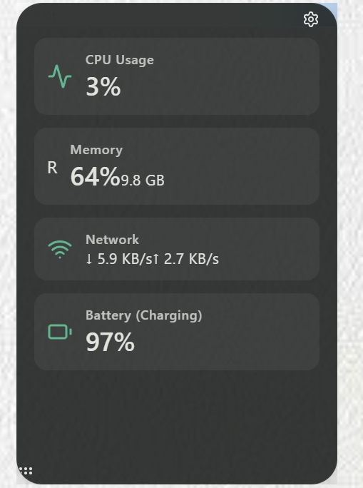

# Toolkit

A lightweight, native always-on-top Windows system monitor built with **Tauri v2**, **Rust**, **React 19**, **TypeScript**, and **Tailwind CSS v4**.

<p align="center">
  
</p>

## Features

- **Real-Time Telemetry (`sys://metrics`)**: Event-driven Rust polling (`sysinfo` + Win32 battery APIs) streaming CPU usage, RAM consumption, network upload/download rates, and battery status once per second without IPC polling overhead.
- **Physical Adapter Filtering**: Excludes loopback (`lo`) and virtual adapters (VMware, Docker, WSL, Hyper-V, Tailscale, WireGuard, Npcap, Bluetooth) while accurately retaining physical Ethernet and Wi-Fi adapters.
- **Idle Polling Pause**: Automatically suspends background metric sampling when the widget is minimized or hidden to the system tray (`Condvar`-driven wakeup on show).
- **Explicit EN / 中 Bilingual UI & Tray Sync**: Instant in-app language toggle (`EN / 中`) persisted in `localStorage` and synchronized with native Windows system tray menu labels (`set_tray_language`).
- **Dynamic Layout Sizing**: Measures visible card stack and settings panel heights with `ResizeObserver` to resize cleanly without card clipping.
- **Native Desktop Integration**: Single-instance lock (`tauri-plugin-single-instance`), remembered window position (`tauri-plugin-window-state`), optional silent startup to tray (`--autostart` via `tauri-plugin-autostart`), and hardened Tauri v2 capabilities & CSP.

## Tech Stack

- **Backend**: Rust 2021, Tauri v2 (`tray-icon`), `sysinfo`, `windows`, `tauri-plugin-autostart`, `tauri-plugin-single-instance`, `tauri-plugin-window-state`
- **Frontend**: React 19, TypeScript, Vite, Tailwind CSS v4, Lucide Icons, Vitest

## Development

### Prerequisites

- **Windows 10 / 11** with Microsoft Edge WebView2
- **Node.js** v18.0.0 or higher (CI runs Node 22)
- **Rust** stable toolchain (`rustup update stable`) with MSVC Build Tools or MSYS2 MinGW64

### Local Setup

```bash
git clone https://github.com/AndrewWangDev/Monitor_Tool.git
cd Monitor_Tool
npm install
npm run tauri dev
```

### Verification & Build

```bash
# Run frontend unit tests & TypeScript/Vite build
npm test
npm run build

# Verify Rust formatting, strict Clippy lints, and unit tests
cargo fmt --manifest-path src-tauri/Cargo.toml -- --check
cargo clippy --manifest-path src-tauri/Cargo.toml -- -D warnings
cargo test --manifest-path src-tauri/Cargo.toml

# Build production Windows installer & standalone binary
npm run tauri build
```

## Contributing & Security

- Read [CONTRIBUTING.md](.github/CONTRIBUTING.md) before opening a pull request.
- Report security vulnerabilities privately following [SECURITY.md](.github/SECURITY.md).

## License

Licensed under the [MIT License](LICENSE) (`SPDX-License-Identifier: MIT`). Copyright (c) 2026 Andrew Wang Dev.
